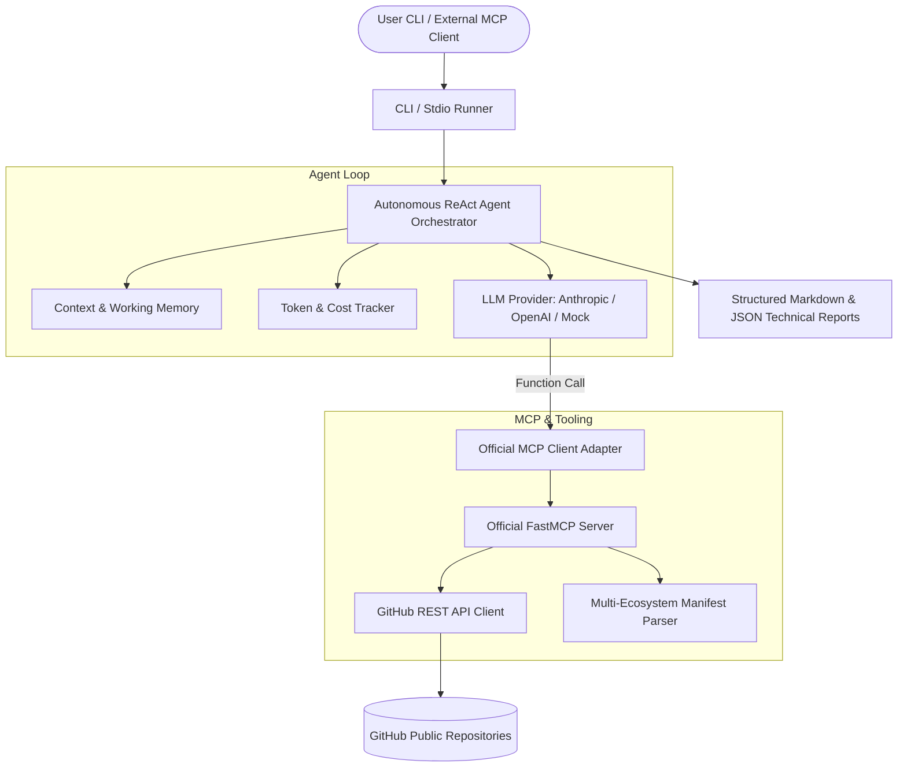

# AI Repository Analyst 🔍🤖

[](https://www.python.org/)
[](https://modelcontextprotocol.io/)
[](https://docs.anthropic.com/)
[]()
[](https://opensource.org/licenses/MIT)

An autonomous AI Agent and official **Model Context Protocol (MCP)** server that deeply inspects public GitHub repositories, analyzes architecture, detects frameworks & dependencies, surfaces technical risks, and produces evidence-backed technical reports.

Unlike basic LLM chatbots that send an entire repository or file into a single prompt, **AI Repository Analyst** runs a **dynamic ReAct (Reasoning + Acting) loop**: it formulates inspection hypotheses, queries repository trees, parses multi-ecosystem manifests (Python, Node.js, Android/Gradle, Unity Engine), extracts line-bounded source files, and rigorously tracks token expenditures against real provider rate cards.

---

## 🏛️ Architecture Overview



---

## ✨ Key Engineering Features

1. **Autonomous ReAct Loop**: The agent determines which tools to call dynamically based on its findings, rather than executing a hardcoded sequence.
2. **Official Model Context Protocol (MCP)**:
   - Exposes analysis tools via the official Python `mcp` SDK (`mcp>=1.0.0`, `mcp 2.x`).
   - The same server can run standalone (`--serve-mcp`) and plug directly into **Claude Desktop**, **Claude Code**, or **Antigravity**.
3. **Multi-Ecosystem Manifest Inspection**:
   - Built-in parsers for `requirements.txt`, `pyproject.toml`, `package.json`, Android `build.gradle`, iOS `Podfile`, and **Unity Package Manager** (`Packages/manifest.json`).
4. **Token & Cost Telemetry**:
   - Calculates prompt tokens, completion tokens, and Anthropic prompt caching savings.
   - Computes total USD run costs based on official rate cards (`claude-3-5-sonnet-20241022`, `claude-3-5-haiku-20241022`, `gpt-4o`, `gpt-4o-mini`).
5. **Evidence-Grounded Reporting**:
   - Distinguishes **verified facts** (validated against real file paths and line ranges) from **architectural inferences**.
   - Exports reports in both human-readable Markdown and machine-readable JSON.
6. **Zero-Flake Testing**:
   - 100% passing test suite (`pytest`) with deterministic mock fixtures allowing full agent loops to run in CI without incurring API charges.

---

## 🚀 Quickstart

### 1. Installation

Clone the repository and set up a virtual environment:

```bash
git clone https://github.com/your-username/ai-repo-analyst.git
cd ai-repo-analyst

python -m venv .venv
# Windows:
.\.venv\Scripts\activate
# Linux/macOS:
source .venv/bin/activate

pip install -r requirements.txt
```

### 2. Environment Configuration

Copy `.env.example` to `.env` and provide your API keys:

```bash
cp .env.example .env
```

```env
# Primary LLM API Key
ANTHROPIC_API_KEY=sk-ant-api03-...

# Optional: Secondary LLM Provider
OPENAI_API_KEY=sk-proj-...

# Optional: GitHub Token (increases rate limit from 60 to 5,000 req/hr)
GITHUB_TOKEN=ghp_...
```

---

## 💻 Usage

### Run Autonomous Analysis via CLI

Analyze any public repository using Anthropic Claude 3.5 Sonnet:

```bash
python -m repo_analyst --repo fastapi/fastapi
```

Target a specific model or provider:

```bash
python -m repo_analyst --repo pallets/flask --provider anthropic --model claude-3-5-haiku-20241022
```

Run in deterministic offline mode (no API key required):

```bash
python -m repo_analyst --repo octocat/Spoon-Knife --provider mock
```

CLI options:
- `--repo`: Target repository (`owner/repo` or full GitHub URL).
- `--provider`: `anthropic` (default), `openai`, or `mock`.
- `--model`: Specific model ID (`claude-3-5-sonnet-20241022`, `gpt-4o`, etc.).
- `--max-turns`: Max ReAct loops allowed (default: 15).
- `--output-dir`: Output directory for generated reports (default: `reports/`).
- `--no-mcp`: Bypass MCP adapter and run directly against internal tool registry.
- `--serve-mcp`: Launch as an MCP stdio server.

---

## 🔌 Using as a Model Context Protocol (MCP) Server

You can connect this tool server directly to **Claude Desktop**, **Claude Code**, or **Antigravity**.

### Claude Desktop Configuration
Add the server to your `claude_desktop_config.json`:

```json
{
  "mcpServers": {
    "repo-analyst": {
      "command": "python",
      "args": [
        "-m",
        "repo_analyst",
        "--serve-mcp"
      ],
      "env": {
        "GITHUB_TOKEN": "your_github_token_here"
      }
    }
  }
}
```

### Tools Exposed Over MCP:
- `repo_get_info`: Fetch repository metadata, stars, default branch, primary language.
- `repo_get_tree`: Traverse recursive file hierarchy.
- `repo_read_file`: Line-range inspection of repository source files.
- `repo_search_code`: Search code patterns across the repository.
- `repo_analyze_manifest`: Parse dependencies from manifests (`package.json`, `requirements.txt`, `build.gradle`, `manifest.json`).

---

## 🧪 Testing

Run the automated test suite:

```bash
pytest
```

Output:
```text
============================= test session starts =============================
platform win32 -- Python 3.12.6, pytest-9.2.0, pluggy-1.7.0
rootdir: C:\Users\User\Desktop\for new job
plugins: anyio-4.16.0, asyncio-1.5.0
collected 13 items

tests\test_agent_loop.py .                                               [  7%]
tests\test_cost_tracker.py ...                                           [ 30%]
tests\test_github_client.py .                                            [ 38%]
tests\test_manifests.py ....                                             [ 69%]
tests\test_mcp.py ..                                                     [ 84%]
tests\test_models.py ..                                                  [100%]

============================= 13 passed in 7.55s ==============================
```

---

## 📊 Sample Output

The agent produces rich, auditable outputs:
- **Terminal Summary**: Live turn-by-turn ReAct observations and execution logs.
- **Markdown Report**: See [`examples/example_report.md`](examples/example_report.md).
- **Structured JSON**: Machine-readable output for automated CI pipelines.
- **Trace Logs**: See [`examples/execution_log.jsonl`](examples/execution_log.jsonl).

---

## 📄 License

MIT License. Free for open-source and commercial use.
